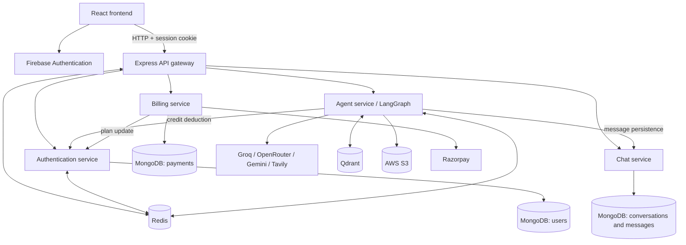

# Braincell

**One workspace. Multiple AI workflows.**

Braincell is a browser-based, multi-agent AI workspace for conversation, research, coding, and creative work. It brings specialized AI workflows into one interface, so users can ask questions, search the web, analyze documents and images, generate code, and create downloadable files without switching between separate tools.

[Explore the repository](https://github.com/HarshithhKumar/braincell) · [Report a bug](https://github.com/HarshithhKumar/braincell/issues)

---

## Overview

Braincell combines a React frontend with an Express API gateway and dedicated backend services for authentication, chat, AI agents, and billing.

Users can start with a guest session or sign in with Google. Conversations and messages are stored in MongoDB, while Redis manages sessions, short-lived conversation memory, and request limits. An agent workflow orchestrated with LangGraph routes requests to the appropriate model and integrations.

### What you can do

| Chat and create | Research and understand | Build and explore |
|---|---|---|
| Chat with AI and revisit saved conversations | Search the web with contextual results | Generate code and view artifacts |
| Generate PDFs and PowerPoint presentations | Ask questions about uploaded PDFs | Analyze uploaded images |
| Generate images from text prompts | Use automatic or manual agent selection | Preview supported HTML artifacts |

## Features

- **Guest access:** Start chatting without creating an account. Guest sessions are maintained with an HTTP-only session cookie and have usage limits.
- **Google authentication:** Sign in through Firebase Authentication. The backend verifies the ID token and creates a server-side session.
- **Conversation history:** Save conversations and messages in MongoDB.
- **Automatic agent routing:** Let Braincell select a workflow based on the prompt or attachment, or choose an agent manually.
- **Web search:** Retrieve web results through Tavily and use the results as context for an answer.
- **Document Q&A:** Upload a PDF and ask questions grounded in its contents using embeddings and vector retrieval.
- **Code artifacts:** Generate code files displayed in a read-only Monaco editor. Supported HTML artifacts can be previewed in a sandboxed iframe.
- **Document generation:** Create downloadable PDF and PowerPoint files.
- **Image workflows:** Generate images from prompts or analyze an uploaded image.
- **Voice input:** Use browser speech recognition where supported.
- **Credits and billing:** Registered users can purchase configured plans through Razorpay. Guest sessions cannot access billing.

## AI capabilities

The agent service uses a LangGraph state graph with a router and task-specific nodes. The table below describes the integrations currently documented in the codebase.

| Workflow | What it does | Main implementation |
|---|---|---|
| Auto routing | Selects a workflow from text prompts or attachment type | Groq-backed classification; PDF and image MIME types route directly to their workflows |
| Chat | Generates conversational responses | Groq `openai/gpt-oss-120b` |
| Search | Retrieves web context and uses it to answer | Tavily, followed by the chat workflow |
| Coding | Generates code explanations or project artifacts | OpenRouter `deepseek/deepseek-chat` |
| PDF generation | Creates a downloadable PDF | Groq for document content, PDFKit for rendering, AWS S3 for storage |
| PDF question answering | Retrieves relevant PDF passages before answering | `pdf-parse`, LangChain text splitting, Gemini `gemini-embedding-001`, Qdrant, and Groq |
| PowerPoint generation | Creates a downloadable presentation | Groq for slide content, PptxGenJS for rendering, AWS S3 for storage |
| Image generation | Creates an image from a text prompt | Groq for prompt preparation, Pollinations for image retrieval, AWS S3 for storage |
| Image analysis | Answers questions about an uploaded image | Google Gemini `gemini-2.5-flash` |

Model availability and provider configuration may change independently of the application.

### Usage limits and credits

- Guest sessions are limited to **30 agent requests per UTC day**.
- Guest-session creation has a per-IP bootstrap limit of **120 per UTC day**.
- Agent-level Redis limits are **20 requests per minute for chat** and **5 per minute** for coding, PDF, PowerPoint, image, and search workflows.
- Configured registered-user credit costs are: chat (1), search (5), coding (10), PDF (10), PowerPoint (10), and vision/image analysis (10).
- Guest sessions do not have MongoDB user records. Their request limits are enforced separately at the gateway.

These values reflect the current repository configuration and may be adjusted by maintainers.

## Technology stack

| Layer | Technologies |
|---|---|
| Frontend | React 19, Vite, Redux Toolkit, Tailwind CSS, Axios, Monaco Editor, React Markdown |
| Backend | Node.js, Express 5, `express-http-proxy`, Multer |
| Data and caching | MongoDB, Mongoose, Redis, ioredis |
| AI orchestration | LangChain.js, LangGraph |
| AI and search providers | Groq, OpenRouter, Google Gemini, Tavily |
| Retrieval | Google Generative AI embeddings, Qdrant |
| Authentication | Firebase Authentication, Firebase Admin, Redis-backed sessions |
| Payments and files | Razorpay, AWS S3, signed S3 URLs, PDFKit, PptxGenJS |
| Infrastructure | Docker, Docker Compose (Redis), GitHub Actions, AWS ECR, ECS, S3, CloudFront |

## Architecture

The application is split into independently configured services. The browser communicates with the API gateway; the gateway validates sessions and routes requests to the relevant backend service.



### Backend services

| Service | Default port | Responsibility |
|---|---:|---|
| API gateway | 8000 | Browser-facing API, session validation, routing, guest limits, and billing authorization |
| Authentication | 8001 | Google token verification, guest sessions, user records, and session management |
| Chat | 8002 | Conversation and message persistence |
| Agent | 8003 | LangGraph workflows, model integrations, file processing, and generated artifacts |
| Billing | 8004 | Razorpay orders, payment verification, and plan updates |

MongoDB connection strings are configured per service. Redis stores sessions, request counters, and cached conversation memory. Internal service URLs are configured through environment variables and should only be reachable by trusted backend services.

## Repository structure

```text
braincell/
├── .github/workflows/       # AWS deployment workflow
├── backend/
│   ├── gateway/             # Express API gateway
│   ├── services/
│   │   ├── auth/            # Authentication and guest sessions
│   │   ├── chat/            # Conversations and messages
│   │   ├── agent/            # LangGraph agents and AI integrations
│   │   └── billing/         # Razorpay and plan management
│   ├── shared/redis/        # Shared Redis client
│   └── docker-compose.yml   # Local Redis container
└── frontend/
    ├── public/
    └── src/
        ├── components/      # Chat, navigation, billing, and artifacts
        ├── features/        # API request logic
        ├── pages/           # Application pages
        └── redux/           # Application state
```

## Getting started

### Prerequisites

- Node.js 20 or newer and npm
- MongoDB
- Redis
- Firebase project with Google sign-in enabled
- Provider credentials for the AI workflows you want to use
- Qdrant for PDF retrieval
- AWS credentials and an S3 bucket for generated files
- Razorpay credentials for payment functionality
- Docker (optional for local development; used by the backend deployment workflow)

### 1. Clone the repository

```bash
git clone https://github.com/HarshithhKumar/braincell.git
cd braincell
```

### 2. Configure environment files

Copy the example file beside each application or service:

```bash
cp frontend/.env.example frontend/.env
cp backend/gateway/.env.example backend/gateway/.env
cp backend/services/auth/.env.example backend/services/auth/.env
cp backend/services/chat/.env.example backend/services/chat/.env
cp backend/services/agent/.env.example backend/services/agent/.env
cp backend/services/billing/.env.example backend/services/billing/.env
```

On Windows PowerShell, use `Copy-Item <example-path> <target-path>` for each file.

Replace the placeholders with your local configuration. Do not commit real credentials or local `.env` files.

For Firebase Admin, set `GOOGLE_APPLICATION_CREDENTIALS` in the auth service environment to the path of your private service-account JSON file. In containers, mount the credential at runtime and point the variable to the mounted path. **Never commit this file or bake it into a Docker image.**

### 3. Start Redis and MongoDB

Start the Redis container from the repository root:

```bash
docker compose -f backend/docker-compose.yml up -d redis
```

Start or provision MongoDB separately. Configure `MONGODB_URI` for the auth, chat, agent, and billing services. The provided Compose file starts Redis only; it does not start MongoDB or the full application.

### 4. Install backend dependencies

Run the following commands from the repository root:

```bash
cd backend && npm install
cd gateway && npm install
cd ../services/auth && npm install
cd ../chat && npm install
cd ../agent && npm install
cd ../billing && npm install
```

### 5. Start backend services

Open a separate terminal for each service and run `npm run dev` from its directory. Start them in this order:

1. `backend/services/auth` — port 8001
2. `backend/services/chat` — port 8002
3. `backend/services/agent` — port 8003
4. `backend/services/billing` — port 8004
5. `backend/gateway` — port 8000

Make sure the gateway's service URLs point to the correct listeners and that `FRONTEND_URL` matches the browser origin.

### 6. Start the frontend

In another terminal:

```bash
cd frontend
npm install
npm run dev
```

Open the Vite development URL, normally [http://localhost:5173](http://localhost:5173). Add the local origin to the authorized domains for your Firebase project and make sure Google sign-in is enabled.

## Environment configuration

Each service has its own `.env.example`. The following table summarizes the main variables; use the example files as the source of truth for service-specific configuration.

| Variable | Used by | Purpose |
|---|---|---|
| `PORT` | Gateway and backend services | HTTP port |
| `FRONTEND_URL` | Gateway | Allowed browser origin for credentialed CORS |
| `AUTH_SERVICE` | Gateway, agent, billing | Auth service base URL |
| `CHAT_SERVICE` | Gateway, agent | Chat service base URL |
| `AGENT_SERVICE` | Gateway | Agent service base URL |
| `BILLING_SERVICE` | Gateway | Billing service base URL |
| `MONGODB_URI` | Auth, chat, agent, billing | MongoDB connection string |
| `REDIS_URL` | Gateway, auth, agent | Redis connection URL |
| `GOOGLE_APPLICATION_CREDENTIALS` | Auth | Path to private Firebase Admin service-account credentials |
| `NODE_ENV` | Gateway, auth | Enables secure session cookies in production |
| `GROQ_API_KEY` | Agent | Groq model access |
| `GOOGLE_API_KEY` | Agent | Gemini and embedding access |
| `OPENROUTER_API_KEY` | Agent | Coding model access |
| `TAVILY_API_KEY` | Agent | Web search |
| `QDRANT_URL`, `QDRANT_API_KEY` | Agent | Vector database connection |
| `AWS_REGION` | Agent | AWS region |
| `AWS_ACCESS_KEY_ID`, `AWS_SECRET_KEY` | Agent | AWS credentials used by the S3 client |
| `AWS_BUCKET_NAME` | Agent | Bucket for generated files |
| `RAZORPAY_KEY_ID`, `RAZORPAY_KEY_SECRET` | Billing | Server-side Razorpay credentials |
| `VITE_SERVER_URL` | Frontend | API gateway base URL |
| `VITE_FIREBASE_API_KEY` | Frontend | Firebase browser app configuration |
| `VITE_RAZORPAY_KEY_ID` | Frontend | Public Razorpay checkout key |

### GitHub Actions deployment secrets

The workflow in `.github/workflows/deploy.yml` expects these repository Actions secrets:

`AWS_REGION`, `AWS_ACCOUNT_ID`, `AWS_ACCESS_KEY`, `AWS_SECRET_ACCESS_KEY`, `ECS_CLUSTER`, `GATEWAY_SERVICE`, `AUTH_SERVICE`, `CHAT_SERVICE`, `AGENT_SERVICE`, `BILLING_SERVICE`, `S3_BUCKET`, `CLOUDFRONT_DISTRIBUTION_ID`, `VITE_SERVER_URL`, `VITE_FIREBASE_API_KEY`, and `VITE_RAZORPAY_KEY_ID`.

Configure the matching AWS resources and secrets before running the deployment workflow. Keep all secret values out of source control.

## API reference

The following routes are exposed by the gateway. Protected routes require the `session` cookie created by login or guest-session creation.

| Method | Route | Access | Purpose |
|---|---|---|---|
| `POST` | `/api/auth/guest` | Public | Create a guest session and set the session cookie |
| `POST` | `/api/auth/login` | Public | Verify a Firebase ID token and create a user session |
| `GET` | `/api/auth/logout` | Optional session | Clear the current session |
| `GET` | `/api/me` | Session | Return the current user or guest session |
| `GET` | `/api/chat/create-conversation` | Session | Create a conversation |
| `GET` | `/api/chat/get-conversations` | Session | List conversations |
| `POST` | `/api/chat/update-conversation` | Session | Update a conversation title |
| `GET` | `/api/chat/get-messages/:conversationId` | Session | Retrieve conversation messages |
| `POST` | `/api/agent/chat` | Session | Run an agent workflow; accepts multipart form data |
| `POST` | `/api/billing/create` | Registered user | Create a Razorpay order |
| `POST` | `/api/billing/verify` | Registered user | Verify payment and apply the plan |

### Request details

- `POST /api/auth/login`: JSON body containing `{ "token": "<Firebase ID token>" }`.
- `POST /api/chat/update-conversation`: JSON body containing `{ "id": "<conversation id>", "title": "<title>" }`.
- `POST /api/agent/chat`: `multipart/form-data` with `prompt`, `conversationId`, and `agent`; optional `file` attachment (PDF or image, maximum 20 MB).
- `POST /api/billing/create`: JSON body containing `{ "plan": "starter" }` or `{ "plan": "pro" }`.
- `POST /api/billing/verify`: Razorpay payment fields `razorpay_order_id`, `razorpay_payment_id`, and `razorpay_signature`.

Common gateway responses include 401 for missing or expired sessions, 403 for guest billing access, 404 for unknown routes or missing resources, 429 for usage limits, and 500/502 for server or upstream failures.

## Authentication and data

### Authentication flow

1. The frontend uses Firebase's Google provider to obtain an ID token.
2. The auth service verifies the token with Firebase Admin, finds or creates the MongoDB user, stores a session in Redis, and returns an HTTP-only cookie.
3. A visitor can instead create a guest session. The auth service generates a guest identity and stores its session in Redis.
4. Gateway middleware reads the session cookie and validates the session against Redis.
5. The gateway forwards the session user ID to chat and agent services. Billing routes require a registered user.

Sessions expire after seven days. Cookies use `HttpOnly` and `SameSite=Strict`; the `Secure` flag is enabled when `NODE_ENV=production`.

### Data stores

**MongoDB**
- `users`: Firebase UID, profile details, plan, credits, plan expiry, and timestamps.
- `conversations`: title, owner ID, and timestamps.
- `messages`: conversation reference, role, text, image URLs, artifacts/files, and timestamps.
- `payments`: user ID, Razorpay identifiers, amount, currency, credits, plan, payment state, and timestamps.

**Redis**
- User and guest session records with seven-day expiry.
- Registered-user session lookup for refreshing session data after plan or credit changes.
- Guest bootstrap and daily request counters.
- Per-user/per-agent minute rate limits.
- Cached agent conversation history.

## Deployment

The repository contains a Dockerfile for each backend service. These images use the `backend` directory as their Docker build context.

The GitHub Actions workflow runs on pushes to `main`. It builds and pushes backend images to AWS ECR, requests ECS service deployments, builds the frontend, syncs `frontend/dist` to S3, and invalidates CloudFront. The frontend build receives its `VITE_*` configuration from repository Actions secrets.

The included Compose file starts Redis only. MongoDB and external AI, payment, and storage providers must be configured separately. There is no Render configuration or full-application Docker Compose deployment in this repository.

For production deployments:
- Keep backend services private behind the gateway.
- Use HTTPS for browser traffic.
- Supply credentials through the hosting platform's secret manager.
- Restrict CORS to the intended frontend origin.
- Keep MongoDB, Redis, and internal service ports inaccessible to untrusted networks.

## Security

- Never commit `.env` files, Firebase Admin service-account JSON, API tokens, payment secrets, cloud credentials, database connection strings, or private keys.
- Provide Firebase Admin credentials at runtime. Do not include the service-account file in a container image.
- Restrict the Firebase browser API key to the intended application and APIs.
- Keep internal backend services private. The gateway forwards user IDs in headers, so internal services must not accept untrusted public requests.
- Use HTTPS and secure cookies in production.
- Treat rate limits as one layer of abuse protection, not a replacement for provider quotas and monitoring.
- Keep Razorpay secrets on the server and verify payments using the server-side signature flow.

## Screenshots

Product screenshots will be added here when the current UI captures are available. No illustrative or placeholder images are presented as live product screenshots.

| Chat workspace | Conversation history |
|---|---|
| _Screenshot coming soon_ | _Screenshot coming soon_ |

| Code artifact | Billing |
|---|---|
| _Screenshot coming soon_ | _Screenshot coming soon_ |

## Roadmap

Potential areas for future development:

- Add automated unit, API, and multi-service integration tests.
- Provide a full local Compose environment with MongoDB and service health checks.
- Validate environment configuration at startup and report missing dependencies clearly.
- Strengthen service-to-service authentication and deployment network boundaries.
- Improve user-scoped document indexing and vector-store cleanup.
- Add durable upload cleanup, file limits, and clearer provider error reporting.
- Pin Docker base images and add repeatable dependency and security scanning.
- Improve conversation pagination, accessibility, and account/billing history.

## Contributing

Contributions are welcome.

1. Fork the repository.
2. Create a focused feature or fix branch.
3. Install dependencies for the frontend or backend service you are changing.
4. Keep credentials in local environment files or a secret manager. Never commit private credentials.
5. Run `npm run lint` and `npm run build` in `frontend`, then run relevant backend syntax checks and service tests.
6. Open a pull request with a clear description of the change, configuration updates, and validation performed.

There is currently no automated backend test suite configured in the root backend package.

## License

No license file is currently included in this repository. Until a license is added, all rights are reserved.
