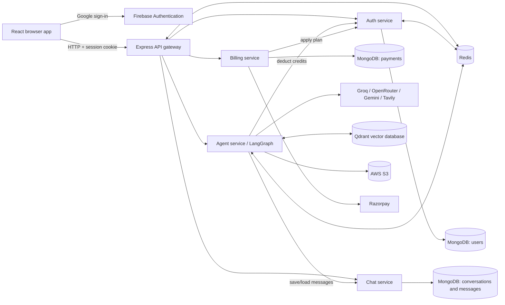

# Braincell

**A multi-agent AI workspace for conversation, research, coding, and creative work.**

Braincell is a browser-based AI application backed by an Express API gateway and separate authentication, chat, agent, and billing services. Users can start a guest session or sign in with Google, work in saved conversations, and ask specialized AI workflows to search the web, analyze documents and images, generate code artifacts, and create downloadable files.

## Contents

- [Project overview](#project-overview)
- [Features](#features)
- [AI capabilities](#ai-capabilities)
- [Technology stack](#technology-stack)
- [Architecture](#system-architecture)
- [Project structure](#project-structure)
- [Requirements and setup](#requirements-and-setup)
- [Environment variables](#environment-variables)
- [API reference](#api-reference)
- [Authentication and authorization](#authentication-and-authorization)
- [Data model](#data-model)
- [AI request lifecycle](#ai-request-lifecycle)
- [Deployment](#deployment)
- [Security notes](#security-notes)
- [Screenshots](#screenshots)
- [Planned improvements](#planned-improvements)
- [Contributing](#contributing)
- [License](#license)

## Project overview

Braincell provides a single chat workspace for general questions and selected creative or research tasks. It routes user prompts to a LangGraph workflow, saves conversations and messages in MongoDB, and uses Redis for sessions, short-lived chat memory, and rate limits. The UI also includes code-artifact preview, file attachments, conversation history, and registered-user billing.

The current implementation is intended for users who want to explore an idea through chat, request code, search for current information, analyze an uploaded PDF or image, or create a PDF, presentation, or generated image. Guest sessions can use chat features with limits; billing is restricted to registered users.

## Features

- **Google sign-in:** Firebase Authentication obtains a Google ID token; the auth service verifies it with Firebase Admin and creates a server-side session.
- **Guest sessions:** A guest can begin without signing in. The session is stored in Redis and represented by an HTTP-only cookie.
- **Chat and conversation history:** Conversations and messages are stored in MongoDB and are associated with the authenticated user or guest identifier.
- **Automatic and manual agent selection:** Users can select Chat, Search, Coding, PDF, PPT, or Vision. In Auto mode, text prompts use an LLM router and PDF/image attachments select the corresponding document or image-analysis workflow; an explicitly selected agent takes precedence.
- **Web search:** Search uses Tavily and can include search-result images; the result context is then passed to the chat agent.
- **PDF and image uploads:** The agent service accepts one PDF or image attachment per chat request, with a 20 MB file-size limit.
- **PDF question answering:** Uploaded PDFs are parsed, split into overlapping text chunks, indexed in Qdrant, and searched for relevant context before answering.
- **Generated code artifacts:** Coding requests can return files rendered in a read-only Monaco editor. HTML artifacts can be previewed in a sandboxed iframe.
- **Generated documents:** PDF and PowerPoint workflows create downloadable files and store them in S3. The application returns time-limited signed download links.
- **Image generation and analysis:** Image generation creates a prompt and fetches an image from Pollinations before storing it in S3. Image analysis sends the uploaded image to Gemini.
- **Voice input:** The chat composer can use the browser's Web Speech recognition implementation when available.
- **Billing and credits:** Registered users can create Razorpay orders for the configured Starter and Pro plans. Guest access is rejected by the gateway's billing authorization middleware.
- **Usage controls:** Guest sessions are limited to 30 agent requests per UTC day. Guest-session creation has a per-IP bootstrap limit of 120 per UTC day. The agent service also maintains per-agent Redis limits per minute.

## AI capabilities

The agent service builds a LangGraph state graph with an LLM-based router and task-specific nodes. The models and integrations below reflect the implementation in this repository; provider availability and model names are controlled by their respective services.

| Workflow | Input and output | Implementation |
|---|---|---|
| Auto routing | Prompt, optionally a file; selects a workflow | Groq-backed LLM classification for text; PDF and image MIME types select document or image analysis directly |
| Chat | Prompt and conversation history; Markdown/text response | Groq `openai/gpt-oss-120b`; history is cached in Redis and loaded from the chat service when not cached |
| Search | Search query; search context and optional images for the answer | Tavily returns up to five results; the graph then runs the chat node using those results |
| Coding | Coding prompt; Markdown explanation or a JSON-defined project artifact | OpenRouter `deepseek/deepseek-chat`; generated file content is displayed in the artifact panel |
| PDF generation | Topic prompt; generated PDF download link | Groq creates structured document content; PDFKit renders the PDF and AWS S3 stores it |
| PDF question answering | Prompt and uploaded PDF; answer grounded in the uploaded document | `pdf-parse`, LangChain text splitting (1,000-character chunks, 200-character overlap), Google `gemini-embedding-001` embeddings, Qdrant similarity search (top five), and Groq |
| PowerPoint generation | Topic prompt; generated presentation download link | Groq creates slide content; PptxGenJS creates a cover, six requested content slides, and a closing slide; AWS S3 stores the file |
| Image generation | Text prompt; generated image and download link | Groq turns the request into an image prompt; the service fetches the image from Pollinations and stores it in S3 |
| Image analysis | Prompt and uploaded image; text response | Google Gemini `gemini-2.5-flash` receives the image and prompt |

Credit deductions are requested from the auth service after a model operation. Current configured costs are 1 for chat, 5 for search, 10 for coding, 10 for PDF, 10 for PPT, and 10 for vision/image analysis. Guest sessions do not have a MongoDB user record; their separate request limits are enforced at the gateway. The agent service's Redis minute limits are 20 for chat and 5 for coding, PDF, PPT, image, and search.

## Technology stack

| Area | Technologies used |
|---|---|
| Frontend | React 19, Vite, Redux Toolkit, Tailwind CSS, Axios, Monaco Editor, React Markdown |
| Backend | Node.js, Express 5, `express-http-proxy`, Multer |
| Database | MongoDB with Mongoose; Redis with ioredis |
| AI/ML | LangChain.js, LangGraph, Groq, OpenRouter, Google Gemini, Google Generative AI embeddings, Tavily, Qdrant |
| Authentication | Firebase Authentication (Google provider) and Firebase Admin ID-token verification; Redis-backed sessions |
| Payments and files | Razorpay, AWS S3, signed S3 download URLs, PDFKit, PptxGenJS |
| Infrastructure | Dockerfiles per backend service; Docker Compose for Redis only |
| Deployment | GitHub Actions workflow for AWS ECR/ECS backend deployment and S3/CloudFront frontend deployment |

## System architecture



The browser sends credentialed requests to the gateway (`VITE_SERVER_URL`). The gateway validates the `session` cookie against Redis for protected routes, then forwards the authenticated user ID to chat and agent services in the `x-user-id` header. The gateway protects billing routes with an additional registered-user check. The guest bootstrap route uses Node's HTTP/HTTPS client to forward the auth service's status, body, and `Set-Cookie` header.

Services use separate MongoDB connection strings and databases as configured by operators. Redis stores sessions and other transient state. Service-to-service calls (agent-to-chat, agent-to-auth, and billing-to-auth) use their configured internal service URLs. They should be reachable only from trusted backend services in a deployed environment.

## Project structure

```text
.
├── .github/
│   └── workflows/
│       └── deploy.yml              # AWS build and deployment workflow
├── .gitignore
├── README.md
├── backend/
│   ├── .dockerignore               # Excludes credentials and local files from build context
│   ├── docker-compose.yml          # Local Redis container only
│   ├── package.json
│   ├── package-lock.json
│   ├── gateway/
│   │   ├── .dockerignore
│   │   ├── .env.example
│   │   ├── Dockerfile
│   │   ├── index.js               # CORS, routes, guest forwarding, rate limit
│   │   ├── package.json
│   │   ├── package-lock.json
│   │   ├── controllers/
│   │   │   └── user.controller.js
│   │   ├── middleware/
│   │   │   └── auth.middleware.js
│   │   └── utils/
│   │       └── proxyWithHeader.js
│   ├── services/
│   │   ├── auth/
│   │   │   ├── .dockerignore
│   │   │   ├── .env.example
│   │   │   ├── Dockerfile
│   │   │   ├── index.js
│   │   │   ├── package.json
│   │   │   ├── package-lock.json
│   │   │   ├── config/
│   │   │   │   ├── db.js
│   │   │   │   └── firebase.js
│   │   │   ├── controllers/
│   │   │   │   ├── auth.controller.js
│   │   │   │   └── guest.controller.js
│   │   │   ├── models/
│   │   │   │   └── user.model.js
│   │   │   └── routes/
│   │   │       └── auth.route.js
│   │   ├── chat/
│   │   │   ├── .dockerignore
│   │   │   ├── .env.example
│   │   │   ├── Dockerfile
│   │   │   ├── index.js
│   │   │   ├── package.json
│   │   │   ├── package-lock.json
│   │   │   ├── config/
│   │   │   │   └── db.js
│   │   │   ├── controllers/
│   │   │   │   └── chat.controller.js
│   │   │   ├── models/
│   │   │   │   ├── coversation.model.js
│   │   │   │   └── message.model.js
│   │   │   └── routes/
│   │   │       └── chat.routes.js
│   │   ├── agent/
│   │   │   ├── .dockerignore
│   │   │   ├── .env.example
│   │   │   ├── Dockerfile
│   │   │   ├── index.js
│   │   │   ├── package.json
│   │   │   ├── package-lock.json
│   │   │   ├── agents/
│   │   │   │   ├── chat.agent.js
│   │   │   │   ├── coding.agent.js
│   │   │   │   ├── imageAnalyzer.agent.js
│   │   │   │   ├── pdf.agent.js
│   │   │   │   ├── pdfRag.agent.js
│   │   │   │   ├── ppt.agent.js
│   │   │   │   ├── search.agent.js
│   │   │   │   └── vision.agent.js
│   │   │   ├── config/
│   │   │   │   ├── agentLimit.js
│   │   │   │   ├── db.js
│   │   │   │   ├── embeddings.js
│   │   │   │   ├── llmModels.js
│   │   │   │   ├── memory.js
│   │   │   │   ├── multer.js
│   │   │   │   ├── s3.js
│   │   │   │   ├── tavily.js
│   │   │   │   └── vectorDb.js
│   │   │   ├── controllers/
│   │   │   │   └── agent.controller.js
│   │   │   ├── graph/
│   │   │   │   ├── graph.js
│   │   │   │   ├── router.js
│   │   │   │   └── state.js
│   │   │   ├── routes/
│   │   │   │   └── agent.route.js
│   │   │   └── utils/
│   │   │       ├── deductCredits.js
│   │   │       ├── generatePdf.js
│   │   │       ├── generatePpt.js
│   │   │       ├── getFromS3.js
│   │   │       ├── getMessages.js
│   │   │       └── uploadToS3.js
│   │   └── billing/
│   │       ├── .dockerignore
│   │       ├── .env.example
│   │       ├── Dockerfile
│   │       ├── index.js
│   │       ├── package.json
│   │       ├── package-lock.json
│   │       ├── config/
│   │       │   ├── db.js
│   │       │   ├── Plans.js
│   │       │   └── razorpay.js
│   │       ├── controllers/
│   │       │   └── billing.controller.js
│   │       ├── models/
│   │       │   └── payment.model.js
│   │       └── routes/
│   │           └── billing.route.js
│   └── shared/
│       └── redis/
│           └── redis.js           # Shared ioredis client
└── frontend/
    ├── .env.example
    ├── .gitignore
    ├── README.md
    ├── eslint.config.js
    ├── firebase.js                # Legacy duplicate Firebase setup (not imported by src)
    ├── index.html                 # Braincell browser title and metadata
    ├── package.json
    ├── package-lock.json
    ├── vite.config.js
    ├── utils/
    │   ├── axios.js
    │   └── firebase.js
    ├── public/
    │   ├── favicon.svg
    │   └── icons.svg
    ├── src/
    │   ├── App.jsx
    │   ├── index.css
    │   ├── main.jsx
    │   ├── assets/
    │   │   ├── hero.png
    │   │   ├── react.svg
    │   │   └── vite.svg
    │   ├── components/
    │   │   ├── Artifact.jsx
    │   │   ├── BillingDrawer.jsx
    │   │   ├── ChatArea.jsx
    │   │   ├── ChatInput.jsx
    │   │   ├── LoadingAnimation.jsx
    │   │   ├── MessageBubble.jsx
    │   │   ├── MessageList.jsx
    │   │   ├── Nav.jsx
    │   │   └── SideBar.jsx
    │   ├── features/
    │   │   ├── createConversation.js
    │   │   ├── createGuestSession.js
    │   │   ├── createOrder.js
    │   │   ├── getConversations.js
    │   │   ├── getCurrentUser.js
    │   │   ├── getMessages.js
    │   │   ├── logOut.js
    │   │   ├── sendMessage.js
    │   │   ├── updateConversation.js
    │   │   └── verifyPayment.js
    │   ├── pages/
    │   │   └── Home.jsx
    │   └── redux/
    │       ├── conversationSlice.js
    │       ├── messageSlice.js
    │       ├── store.js
    │       └── userSlice.js
```

Dependency directories, local `.env` files, the auth service-account JSON, and generated agent upload files are intentionally not part of this structure or the repository.

## Requirements and setup

- Node.js 20 or newer (the project dependencies include packages requiring Node 20+; the checked environment used Node 24.18.0).
- npm.
- MongoDB, reachable using a separate connection string for each service.
- Redis. The provided Compose file starts Redis only.
- Firebase project credentials and Google sign-in configuration.
- Provider credentials for the AI workflows you intend to use (Groq, Google AI, OpenRouter, Tavily, and Qdrant).
- AWS credentials and an S3 bucket for generated downloadable files.
- Razorpay credentials for registered-user checkout.
- Docker is optional for local Node development and required by the existing backend container build/deploy workflow.

### 1. Clone and configure

```bash
git clone https://github.com/HarshithhKumar/braincell.git
cd braincell
```

Copy each example to a service-local `.env` file and replace the placeholders:

```bash
cp frontend/.env.example frontend/.env
cp backend/gateway/.env.example backend/gateway/.env
cp backend/services/auth/.env.example backend/services/auth/.env
cp backend/services/chat/.env.example backend/services/chat/.env
cp backend/services/agent/.env.example backend/services/agent/.env
cp backend/services/billing/.env.example backend/services/billing/.env
```

On Windows PowerShell, use `Copy-Item frontend/.env.example frontend/.env` (and repeat for the other paths). Do not copy real credentials into an example file or commit a `.env` file.

Provide Firebase Admin credentials to the auth service using Application Default Credentials. For local development, set `GOOGLE_APPLICATION_CREDENTIALS` in `backend/services/auth/.env` to the path of a downloaded service-account JSON file; keep that file untracked. In containers, mount the credential as a runtime secret and set this variable to its container path. Do not bake the credential into an image.

### 2. Start Redis and MongoDB

```bash
docker compose -f backend/docker-compose.yml up -d redis
```

Start or provision MongoDB separately and set `MONGODB_URI` in auth, chat, agent, and billing service environments. The repository does not include a MongoDB container or a full-stack Compose configuration.

### 3. Install and start backend services

From the repository root, install the shared backend dependency and each service's dependencies:

```bash
cd backend && npm install
cd gateway && npm install
cd ../services/auth && npm install
cd ../chat && npm install
cd ../agent && npm install
cd ../billing && npm install
```

Start each service in its own terminal using `npm run dev`, from its directory, in this order:

1. `backend/services/auth` (port 8001)
2. `backend/services/chat` (port 8002)
3. `backend/services/agent` (port 8003)
4. `backend/services/billing` (port 8004)
5. `backend/gateway` (port 8000)

Service ports and URLs can be changed through their respective environment files. Ensure the gateway's service URLs match those listeners and that the browser origin matches `FRONTEND_URL`.

### 4. Start the frontend

```bash
cd frontend
npm install
npm run dev
```

Open the Vite URL (by default `http://localhost:5173`). The browser Firebase project must have Google sign-in enabled and the local origin authorized.

## Environment variables

Use the corresponding `.env.example` beside each service. Examples contain placeholders, not production credentials.

| Variable | Used by | Purpose |
|---|---|---|
| `PORT` | Gateway and each backend service | HTTP listen port (defaults in the examples: 8000–8004) |
| `FRONTEND_URL` | Gateway | Allowed CORS browser origin; credentials are enabled |
| `AUTH_SERVICE` | Gateway, agent, billing | Auth service base URL |
| `CHAT_SERVICE` | Gateway, agent | Chat service base URL |
| `AGENT_SERVICE` | Gateway | Agent service base URL |
| `BILLING_SERVICE` | Gateway | Billing service base URL |
| `MONGODB_URI` | Auth, chat, agent, billing | MongoDB connection string for that service |
| `REDIS_URL` | Gateway, auth, agent | Redis connection URL |
| `GOOGLE_APPLICATION_CREDENTIALS` | Auth | Runtime file path used by Firebase Admin Application Default Credentials; the credential file itself must remain private |
| `NODE_ENV` | Gateway, auth | Set to `production` to enable the `Secure` session cookie flag |
| `GROQ_API_KEY` | Agent | Groq chat/completion provider |
| `GOOGLE_API_KEY` | Agent | Google Gemini and embedding provider |
| `OPENROUTER_API_KEY` | Agent | OpenRouter coding model provider |
| `TAVILY_API_KEY` | Agent | Tavily web search |
| `QDRANT_URL` | Agent | Qdrant endpoint for PDF vector search |
| `QDRANT_API_KEY` | Agent | Qdrant cloud credential; the LangChain integration also reads this standard environment variable |
| `AWS_REGION` | Agent | AWS region for S3 |
| `AWS_ACCESS_KEY_ID` | Agent | AWS access key ID used by the S3 client |
| `AWS_SECRET_KEY` | Agent | AWS secret access key used by the S3 client |
| `AWS_BUCKET_NAME` | Agent | S3 bucket for generated PDF, PPT, and image files |
| `RAZORPAY_KEY_ID` | Billing | Razorpay server SDK key ID |
| `RAZORPAY_KEY_SECRET` | Billing | Razorpay server secret used to verify payment signatures |
| `VITE_SERVER_URL` | Frontend | Credentialed API gateway base URL |
| `VITE_FIREBASE_API_KEY` | Frontend | Firebase browser app configuration; this is delivered to the browser and must be restricted in Firebase/Google Cloud settings |
| `VITE_RAZORPAY_KEY_ID` | Frontend | Razorpay checkout public key ID |

No GitHub Actions deployment secrets are currently required. Configure provider credentials and frontend build variables directly in the hosting platform you choose.

## API reference

Browser-facing routes below are served by the gateway. Unless stated otherwise, successful JSON responses use HTTP 200. Protected routes require the `session` cookie set by login or guest-session creation.

| Method and path | Access | Request | Response and behavior |
|---|---|---|---|
| `POST /api/auth/guest` | Public | No body required | Guest profile JSON and `Set-Cookie: session=...`; 429 when the daily per-IP bootstrap limit is exceeded |
| `POST /api/auth/login` | Public | JSON `{ "token": "<Firebase ID token>" }` | User JSON and session cookie; invalid or expired tokens return 401 |
| `GET /api/auth/logout` | Session cookie optional | None | Deletes the current Redis session when present, clears the cookie, and returns a logout message |
| `GET /api/me` | Session | None | Current user or guest session object |
| `GET /api/chat/create-conversation` | Session | None | Creates and returns a conversation |
| `GET /api/chat/get-conversations` | Session | None | Returns the current user's conversations, newest updated first |
| `POST /api/chat/update-conversation` | Session | JSON `{ "id": "<conversation id>", "title": "<title>" }` | Updated conversation; 404 if it does not belong to the current user |
| `GET /api/chat/get-messages/:conversationId` | Session | Conversation ID in path | Returns that user's messages; 404 when the conversation is missing or belongs to another user |
| `POST /api/agent/chat` | Session | `multipart/form-data`: `prompt`, `conversationId`, `agent`; optional `file` (PDF/image, max 20 MB) | `{ "answer": "...", "images": [], "artifacts": [] }`; 400 for missing prompt/conversation, 429 for limits |
| `POST /api/billing/create` | Registered user session | JSON `{ "plan": "starter" }` or `{ "plan": "pro" }` | Razorpay order and plan; 403 for guests |
| `POST /api/billing/verify` | Registered user session | Razorpay fields `razorpay_order_id`, `razorpay_payment_id`, `razorpay_signature` | Verifies the payment signature and applies the saved payment plan; invalid signature returns 400 |

The chat service's internal routes are called through the gateway paths above. The agent and billing services also call internal auth/chat endpoints directly:

| Internal route | Caller | Purpose |
|---|---|---|
| `POST /login`, `POST /guest` | Gateway | Auth service login and guest bootstrap handlers |
| `GET /logout` | Direct auth-service route (not proxied by the gateway) | Auth-service logout handler; the browser-facing gateway logout is handled locally at `GET /api/auth/logout` |
| `POST /update-plan` | Billing service | Applies paid plan and credits to a MongoDB user and refreshes the Redis session |
| `POST /deduct-credits` | Agent service | Deducts the configured amount from a registered MongoDB user |
| `POST /save-message`, `GET /get-messages/:conversationId` | Agent service | Persists messages and loads conversation history |

Common gateway errors include 401 for a missing/expired session, 403 for guest billing access, 404 for unknown routes or missing conversations/plans, 429 for usage limits, and 500/502 for server or upstream failures. The individual services may return additional validation or provider errors.

## Authentication and authorization

1. The frontend uses Firebase's Google provider to obtain an ID token.
2. The auth service verifies the token with Firebase Admin, finds or creates a MongoDB user, stores the session record in Redis, and returns an HTTP-only cookie.
3. A guest may instead call the guest endpoint. The auth service creates a random guest identity and Redis session and sets the same cookie.
4. Protected gateway middleware reads the cookie, loads `session-<id>` from Redis, and attaches the session user to the request.
5. The gateway forwards the user ID to chat and agent services. Billing middleware rejects guests.

Sessions expire after seven days. Cookies use `HttpOnly` and `SameSite=Strict`; the `Secure` flag is enabled when `NODE_ENV=production`. The gateway's CORS configuration allows the configured frontend origin and credentials.

## Data model

MongoDB models:

- **User** (`users`): Firebase UID, name, email, avatar, plan, current and total credits, plan expiry, and Mongoose timestamps.
- **Conversation** (`conversations`): title, owner `userId`, and timestamps.
- **Message** (`messages`): conversation reference, `user`/`assistant` role, text, image URLs, generated artifacts/files, and timestamps.
- **Payment** (`payments`): user ID, Razorpay order/payment IDs, amount, currency, credits, plan, payment state, and timestamps.

Redis is used for:

- `session-<sessionId>`: serialized user or guest identity with a seven-day expiry.
- `user-session-<userId>`: registered user's current session ID, used to refresh session data after plan/credit changes.
- Guest-session bootstrap counts and daily guest agent request counts.
- Per-user/per-agent minute rate limits.
- Agent conversation history used as a cache.

## AI request lifecycle

1. The browser sends the prompt, selected workflow, conversation ID, and optional attachment to `POST /api/agent/chat` with the session cookie.
2. The gateway validates the session, applies the guest daily limit when applicable, and proxies the request with `x-user-id`.
3. Multer stores an uploaded PDF/image temporarily. The agent controller saves the user message through the chat service and invokes the LangGraph workflow.
4. Auto mode classifies text prompts; a PDF or image attachment selects the related analyzer. Search requests run Tavily and then the chat workflow.
5. The selected agent invokes its configured model and integrations. Generated downloadable files are stored in S3 and exposed via signed URLs; code generation returns artifact file content.
6. The agent service updates Redis conversation memory, saves the assistant response through the chat service, and returns the answer, images, and artifacts.
7. The frontend renders Markdown, images, and any code artifact. On subsequent loads it retrieves persisted messages and conversations through gateway routes.

## Deployment

The repository includes one Dockerfile for each backend service. They use the `backend` directory as the Docker build context. The included `backend/docker-compose.yml` runs Redis only; MongoDB and the AI, payment, and storage providers must be configured separately.

GitHub Actions deployment has been intentionally removed. The repository does not currently configure automatic deployment from GitHub. Deploy the frontend and backend manually using your chosen hosting provider, and configure the required environment variables and secrets in that provider.

There is no Render configuration or full application Compose deployment in this repository. For production, keep backend services private behind the gateway, use TLS for browser traffic, provide secrets through the platform's secret manager, and configure the exact frontend origin and internal service URLs.

## Security notes

- Never commit `.env` files, Firebase Admin service-account JSON, payment secrets, API tokens, cloud credentials, database connection strings, or private keys. The ignore rules and Docker build-context exclusions protect these files; verify them before publishing.
- Firebase Admin uses Application Default Credentials. Mount or otherwise provide the credential at runtime; do not copy it into a container image.
- Restrict the Firebase browser API key to the intended web app and APIs. It is browser configuration, not a server-side secret.
- Keep MongoDB, Redis, and internal service ports inaccessible to untrusted networks. The gateway forwards user IDs as headers, so internal services must not trust requests from the public internet.
- Session cookies are HTTP-only and same-site strict, and production uses secure cookies. Deploy behind HTTPS and configure the frontend CORS origin narrowly.
- Guest bootstrap, guest usage, and per-agent request limits are implemented with Redis. These limits are not a substitute for provider quotas or abuse monitoring.
- Razorpay payment verification uses an HMAC signature and the server-side secret. Keep all Razorpay secrets server-side.

## Screenshots

Screenshots are intentionally left as placeholders until real product screenshots are added.

<!-- Add genuine screenshots under docs/screenshots/ and link them here. -->

| Screen | Screenshot |
|---|---|
| Chat workspace | _Screenshot to be added_ |
| Conversation history and guest session | _Screenshot to be added_ |
| Generated code artifact | _Screenshot to be added_ |
| Billing plans | _Screenshot to be added_ |

## Planned improvements

The following are potential follow-up work, not claims about existing functionality:

- Add automated unit, API, and multi-service integration tests, including payment-verification and file-upload cases.
- Add a full local Compose setup with MongoDB and health checks for every service.
- Add runtime validation for environment configuration and make service startup fail clearly when required dependencies are unavailable.
- Review internal service authentication and ensure all backend ports are private in deployment.
- Improve durable, user-scoped document/vector indexing and cleanup for PDF retrieval.
- Add durable upload cleanup, limits, and provider error reporting for generated media.
- Pin Docker base images and add repeatable dependency/security scanning to the deployment workflow.
- Improve conversation pagination, accessibility coverage, and user-facing account/billing history.

## Contributing

1. Fork the repository and create a focused branch.
2. Install dependencies in the frontend or backend service you change.
3. Keep credentials in local environment files or a secret manager; never include private credentials in code, logs, screenshots, or example files.
4. Run `npm run lint` and `npm run build` in `frontend`. Run syntax checks and the relevant service/integration tests for backend changes.
5. Describe behavior changes, configuration additions, and test results in your pull request.

There is currently no automated backend test suite configured in the root backend package.

## License

No project license is currently included. All rights are reserved unless the repository owner publishes a license.